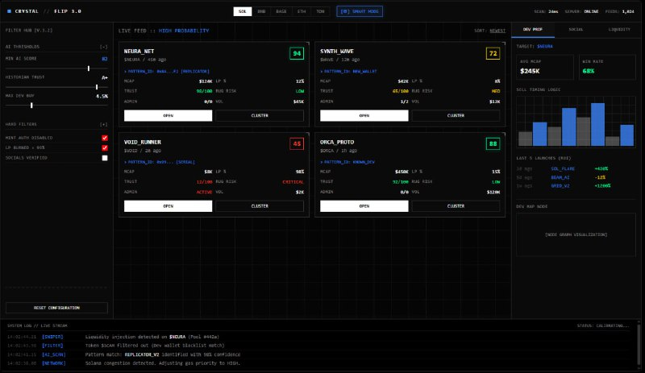

  

<h1 align="center">Crystal Flip</h1>

<strong>Real-time market intelligence for early-stage token launches.</strong>

Crystal Flip is a proprietary desktop analytics platform for discovering, evaluating, and tracking newly launched tokens. It combines continuous market scanning, developer and community history, social intelligence, configurable filters, and automated coin opening in one workspace.

> **Read the Dev before you open the coin.** Crystal Flip is designed to support faster, data-driven research—not to replace independent judgment.

## Overview

New token launches move quickly, and a chart alone rarely tells the full story. Crystal Flip brings the context around a launch into a single decision-making workflow:

- Who launched the token, and what happened to their previous projects?
- How quickly is the launch progressing and migrating?
- Which Twitter account or Community is attached to it?
- What results did that account or Community achieve previously?
- Does current activity match historical developer behavior?
- Does the launch satisfy the user's custom quality filters?

The platform continuously collects public market and social data, maintains historical profiles, and surfaces matching opportunities in real time.

## Product Preview

*Crystal Flip 3.0: real-time detections, scoring, filtering, developer analytics, and market context.*

## Core Capabilities

| Module | What it provides |
| --- | --- |
| **Dev Intelligence** | Previous launches, peak and average MCAP, median performance, dev-buy size, selling behavior, and repeat launch patterns |
| **Migration Scanner** | Real-time migration detection with configurable migration thresholds and automatic opening |
| **Twitter Intelligence** | Attached-tweet analysis, author followers, account history, average MCAP, whitelist/blacklist, and post filtering |
| **Community Analytics** | Community and admin discovery, follower counts, historical launches, average MCAP, and admin-based auto-open |
| **Wallet Tracking** | Automatic detection of new launches from user-specified developer wallets |
| **Contract Alerts** | Monitoring of contract addresses shared on Twitter with source and keyword filters |
| **LaunchCoin Alerts** | Developer identity and Twitter context for newly detected LaunchCoin launches |
| **Crystal AI Score** | A configurable 0–100 assessment based on historical, behavioral, liquidity, and social factors |
| **Risk & Manipulation Signals** | Indicators for artificial growth, suspicious fees, repeated farm behavior, and liquidity risks |
| **Decision History** | Detection history, notes, configurable highlighting, and performance review |

Detailed behavior and available filters are documented in [Features](docs/FEATURES.md).

## Supported Markets

Crystal Flip scans launches across supported venues on **Solana** and **BNB Chain**, including integrations described for:

- Pump.fun
- Bonk
- Boop
- LaunchLab
- LaunchCoin

Availability and data depth can vary by platform. Historical token statistics may not be equally complete across all venues or networks.

## Product Components

### Desktop Application

The main real-time workspace for scanning, filtering, analytics, alerts, notes, detection history, and automatic coin opening. Settings can be imported to reproduce a preferred configuration.

### Crystal Extension

A companion interface layer that adds social and historical context to supported coin views: attached tweet author, followers, token count, average market cap, recent token results, custom highlighting, and whitelist indicators.

### Continuous Data Collection

Server-side collection runs around the clock to build developer, Community admin, and tweet-author histories. Recurring entities are cached so that new launches can immediately be compared with previous activity.

See [Product Architecture](docs/ARCHITECTURE.md) for a conceptual overview. Internal implementation details and source code are not published.

## Crystal AI Score

Every eligible launch can receive a dynamic score from **0 to 100**. The score may incorporate:

- developer performance and behavior;
- Community admin history;
- Twitter historian history and trust signals;
- migration speed and dev-buy size;
- Global Fees Paid;
- liquidity characteristics;
- organic versus artificial growth indicators;
- repeatability of previous launch patterns.

| Score | Interpretation |
| --- | --- |
| **80–100** | Higher-quality setup according to the selected model |
| **60–79** | Mid-tier setup requiring closer review |
| **Below 60** | Elevated risk or insufficient quality signals |

The score is an analytical heuristic, **not a guarantee of performance or financial advice**.

## Typical Workflow

1. Select networks, launch platforms, and detection modules.
2. Set minimum history, migration, social, liquidity, and AI Score thresholds.
3. Configure trusted wallets, Twitter accounts, Community admins, and keyword lists.
4. Let Crystal Flip monitor new launches continuously.
5. Review the evidence behind each detection and its historical context.
6. Open candidates manually or enable rule-based automatic opening.
7. Record notes and review detection history to refine the strategy.

## Access and Pricing

Access is managed through the official Telegram bot: **[@CrystalFlip_bot](https://t.me/CrystalFlip_bot)**.

Current channel materials advertise:

- a free trial (duration may vary by promotion);
- desktop access: **2 SOL for 8 days** or **4 SOL for 16 days**;
- updates and customer support included with active access;
- access to customer instructions and the buyer community.

Pricing and trial terms can change. The official bot is the authoritative source at the time of purchase.

## Official Links

- **Project channel:** [t.me/Crystal_Flip](https://t.me/Crystal_Flip)
- **Access and support:** [t.me/CrystalFlip_bot](https://t.me/CrystalFlip_bot)

## Project Status

Crystal Flip is under active development. Published updates have expanded the product from a launch scanner into a broader analytics and decision-support platform, including BNB support, improved scanning performance, deeper social analytics, historical detection review, and AI-assisted scoring.

Planned capabilities and release timing may change. This repository documents the product at a high level rather than exposing proprietary implementation details.

## Documentation

- [Features and Filters](docs/FEATURES.md)
- [Conceptual Product Architecture](docs/ARCHITECTURE.md)
- [Getting Started](docs/GETTING_STARTED.md)
- [Frequently Asked Questions](docs/FAQ.md)
- [Product Direction](docs/ROADMAP.md)
- [Brand and Press Kit](docs/BRAND.md)
- [Media Gallery](docs/MEDIA_GALLERY.md)
- [Risk and Data Limitations](docs/RISK_AND_LIMITATIONS.md)
- [Changelog](CHANGELOG.md)
- [Security Policy](SECURITY.md)
- [Support](SUPPORT.md)

## Proprietary Software

Crystal Flip is **closed-source commercial software**. No open-source license is granted. Source code, internal algorithms, credentials, private customer material, and server implementation details are not included in this repository.

## Risk Disclaimer

Crystal Flip provides research and automation tools for highly volatile and speculative markets. It does not guarantee token quality, safety, liquidity, or returns. Automated opening is not automated profit. Always verify information independently, use appropriate risk limits, and never commit funds you cannot afford to lose.
