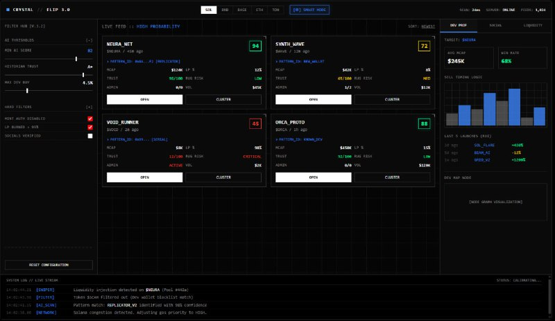
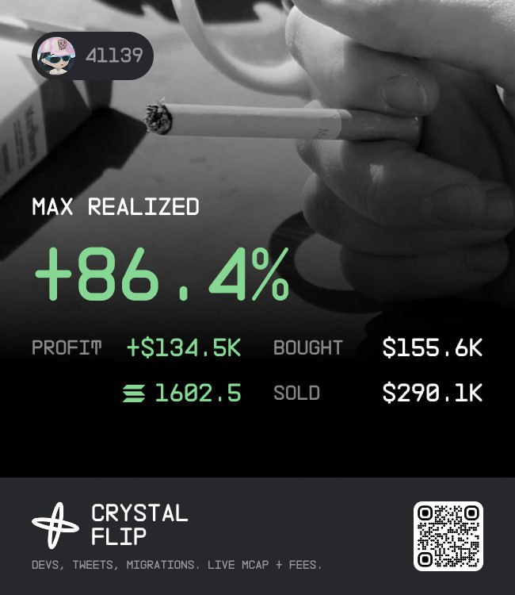
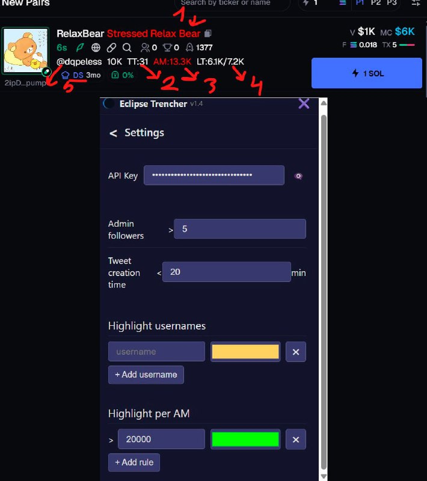
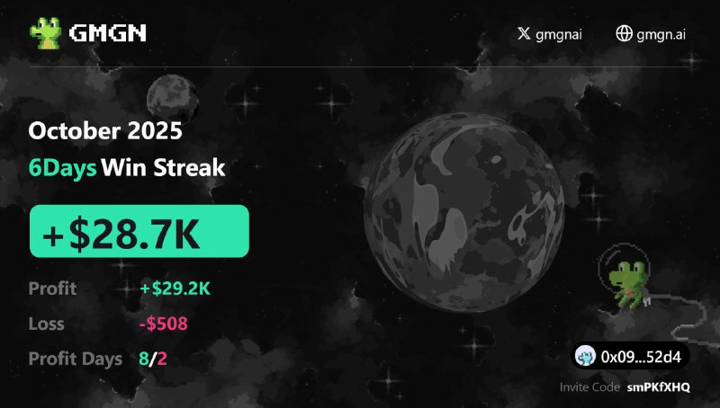
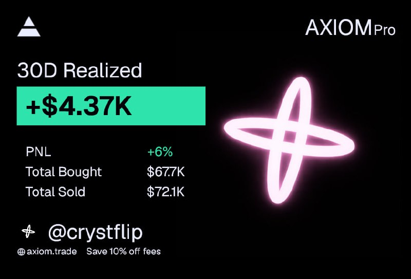
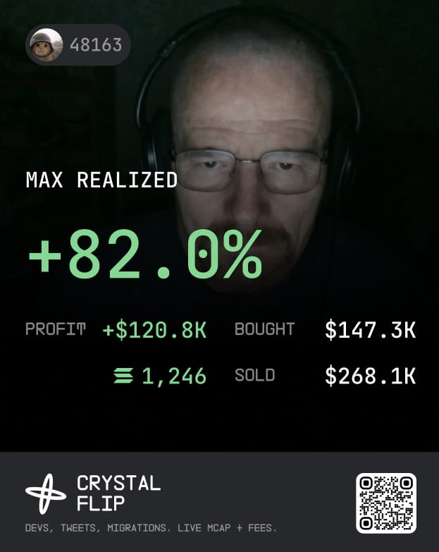
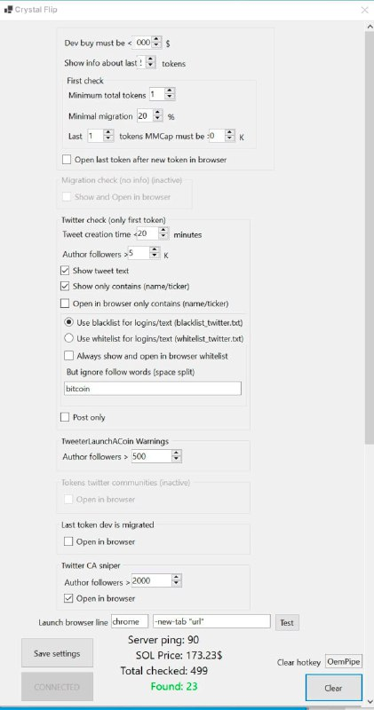
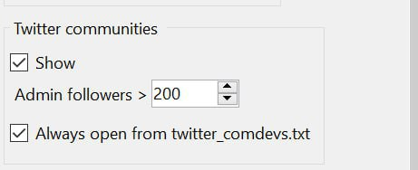

# Crystal Flip Media Gallery

Public product visuals collected from the official [Crystal Flip Telegram channel](https://t.me/Crystal_Flip). These materials are provided for product presentation and documentation; they are not open-source assets.

## Brand Identity

**Crystal Flip** — real-time token discovery, developer history, migrations, social intelligence, and market-cap analytics.

## Crystal Flip 3.0 — Analytical Workspace

The global 3.0 interface presents token detections, Crystal AI Score, developer metrics, launch history, and configurable filters in a single real-time workspace.

## Product Interface and Settings

A recent product update focused on scanning latency, developer analytics, filtering quality, detection history, performance, and stability.

## Crystal Extension

The extension adds historical and social context to supported coin interfaces:

1. Token-name and ticker highlighting.
2. Total tokens associated with the account.
3. Average historical market cap.
4. Recent token performance.
5. Attached tweet author and settings for custom highlights.

## Community Intelligence Update

Version 2.2.0 materials illustrate continuous tweet collection, historian statistics, Global Fees Paid, notes, and configurable console controls.

## BNB Network Expansion

Crystal Flip expanded beyond Solana with BNB support, developer migration analytics, Community history, and Twitter historian statistics.

## Community Admin Statistics

Historical Community-admin statistics provide average market-cap context and previous-token performance when a new launch is detected.

## Product Milestones and Community Materials

### Crystal Flip 3.0 Campaign

### Service Update

### Community Campaign

### Original Product Presentation

### Early Functionality Overview

### Early Community Update

## Usage Notes

- Screenshots represent the releases and campaigns at the time of their original posts.
- Current functionality and interface details may differ.
- Trading screenshots or promotional performance figures are not independently verified and are not promises of future returns.
- All product visuals remain proprietary Crystal Flip materials.
